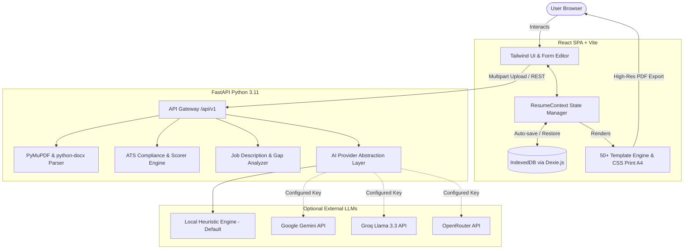

# SYSTEM ARCHITECTURE: AI RESUME BUILDER

## 1. Architectural Philosophy

AI Resume Builder is architected around three non-negotiable tenets:
1. **Privacy-First & Database-Free**: No centralized cloud database (PostgreSQL, MySQL, MongoDB, Firebase, Supabase) is operated. User resume data never persists on our backend servers.
2. **Deterministic Graceful Degradation**: The platform is 100% operational out-of-the-box using the built-in Local Heuristic Provider without requiring users or operators to configure external AI API credentials.
3. **Strict Decoupled Domain Separation**: The React frontend and FastAPI backend operate as completely autonomous applications communicating solely via versioned REST APIs (`/api/v1`).

---

## 2. High-Level System Architecture Diagram

---

## 3. Frontend Architecture

- **Framework**: React 18 with Vite build tool.
- **Language**: Pure ECMAScript JavaScript (JSX), avoiding TypeScript compilation overhead.
- **Styling**: Tailwind CSS with custom typography and color tokens.
- **Local Persistence**: Dexie.js IndexedDB wrapper with debounced auto-saving, draft versioning, and JSON import/export.
- **Template System**: Normalized `ResumeData` consuming 50+ templates across 7 categories (ATS-Friendly, Modern, Minimalist, Student, Developer, Executive, Creative).
- **PDF Generation**: Standardized CSS A4 `@media print` rules paired with client-side canvas/PDF vector rendering.

---

## 4. Backend Architecture

- **Framework**: FastAPI (Python 3.11+) with Uvicorn ASGI server.
- **Data Validation**: Pydantic v2 schemas for all requests, responses, and entities.
- **Document Processing**:
  - `PyMuPDF` (`pymupdf`) for high-fidelity multi-page PDF text extraction.
  - `python-docx` for structured Word document extraction.
- **Security & Hygiene**:
  - Secure temporary upload context manager with guaranteed cleanup.
  - 10MB upload payload limit.
  - Filename sanitization against path-traversal attacks.
  - Configurable CORS origins.
