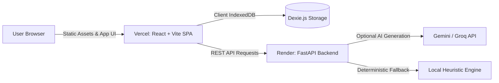

# PRODUCTION DEPLOYMENT GUIDE: RENDER (BACKEND) & VERCEL (FRONTEND)

This guide walks you step-by-step through deploying the **AI Resume Builder** application to production using **Render** for the Python FastAPI backend and **Vercel** for the React + Vite frontend.

---

## Architecture Overview



* **Frontend**: React 18, Vite, Tailwind CSS, Dexie.js (IndexedDB local-first storage).
* **Backend**: FastAPI, Python 3.11+, PyMuPDF, Python-Docx, Uvicorn ASGI.
* **Database**: Zero external cloud database required (100% private client-side storage).

---

## Part 1: Deploy Backend to Render

### Option A: Using Blueprint (`render.yaml`) — Recommended (1-Click)

The repository includes a pre-configured [render.yaml](file:///c:/Users/sagni/OneDrive/Desktop/project/ai%20resume%20builder/render.yaml) file.

1. Log into your [Render Dashboard](https://dashboard.render.com/).
2. Click **New +** in the top navigation and select **Blueprint**.
3. Connect your GitHub repository: `https://github.com/rootrebels26/Ai-resume-builder.git`.
4. Render will automatically detect `render.yaml` and configure the web service:
   * **Name**: `ai-resume-builder-api`
   * **Root Directory**: `backend`
   * **Runtime**: Python 3
   * **Build Command**: `pip install -r requirements.txt`
   * **Start Command**: `uvicorn app.main:app --host 0.0.0.0 --port $PORT`
   * **Health Check Path**: `/api/v1/health`
5. Click **Apply**.
6. Copy your deployed backend URL (e.g. `https://ai-resume-builder-api.onrender.com`).

---

### Option B: Manual Web Service Setup on Render

1. On the Render Dashboard, click **New +** → **Web Service**.
2. Connect your GitHub repository.
3. Configure the service settings:
   * **Name**: `ai-resume-builder-api`
   * **Region**: Choose closest to your users (e.g., Singapore, Frankfurt, Oregon)
   * **Root Directory**: `backend`
   * **Runtime**: `Python 3`
   * **Build Command**: `pip install -r requirements.txt`
   * **Start Command**: `uvicorn app.main:app --host 0.0.0.0 --port $PORT`
   * **Instance Type**: `Free`
4. Under **Advanced** → **Environment Variables**, add:

| Key | Recommended Value | Description |
| :--- | :--- | :--- |
| `APP_ENV` | `production` | Enables production security mode |
| `API_V1_PREFIX` | `/api/v1` | Base API route prefix |
| `COMPANY_ACCESS_CODE` | `NityaCloudtech#resume` | Company access code required for builder authorization |
| `ALLOWED_ORIGINS` | `https://your-app.vercel.app` | Comma-separated list of allowed frontend domains *(Update after deploying to Vercel)* |
| `AI_PROVIDER` | `gemini` *(or `groq` / `local`)* | AI model provider |
| `GEMINI_API_KEY` | `Your-Gemini-API-Key` | Required if `AI_PROVIDER=gemini` |
| `GROQ_API_KEY` | `Your-Groq-API-Key` | Required if `AI_PROVIDER=groq` |
| `MAX_UPLOAD_SIZE_MB` | `10` | Max document size for PDF/DOCX uploads |

5. Under **Health Check Path**, enter: `/health` (or `/api/v1/health`).
6. Click **Create Web Service**.
7. Once deployment completes, verify:
   ```bash
   curl https://ai-resume-builder-api.onrender.com/health
   # Expected output: {"success":true,"data":{"status":"healthy","version":"1.0.0",...}}
   ```

---

## Part 2: Deploy Frontend to Vercel

1. Log into your [Vercel Dashboard](https://vercel.com/dashboard).
2. Click **Add New...** → **Project**.
3. Import your GitHub repository: `Ai-resume-builder`.
4. In the **Configure Project** screen:
   * **Project Name**: `ai-resume-builder` (or your preferred name)
   * **Framework Preset**: `Vite`
   * **Root Directory**: Click **Edit** and select `frontend` (crucial!)
   * **Build Command**: `npm run build`
   * **Output Directory**: `dist`
   * **Install Command**: `npm install`
5. Expand **Environment Variables** and add:

| Key | Value | Notes |
| :--- | :--- | :--- |
| `VITE_API_BASE_URL` | `https://ai-resume-builder-api.onrender.com` | **Do not** add a trailing slash or `/api/v1` (the client appends `/api/v1` automatically) |

6. Click **Deploy**.
7. In ~30-45 seconds, your application will be live at `https://your-app.vercel.app`.

> [!NOTE]
> Single Page Application client-side routing is automatically handled by the pre-configured [frontend/vercel.json](file:///c:/Users/sagni/OneDrive/Desktop/project/ai%20resume%20builder/frontend/vercel.json), preventing 404 errors when refreshing `/builder`, `/templates`, or `/ats-checker`.

---

## Part 3: Connect Frontend & Backend (CORS Configuration)

Once your Vercel deployment gives you a live domain (e.g. `https://ai-resume-builder-xyz.vercel.app`):

1. Go back to your **Render Dashboard** → select `ai-resume-builder-api`.
2. Navigate to **Environment**.
3. Update the `ALLOWED_ORIGINS` variable:
   ```env
   ALLOWED_ORIGINS=https://ai-resume-builder-xyz.vercel.app,http://localhost:5173
   ```
4. Click **Save Changes**. Render will automatically redeploy the backend with the updated CORS policy.

---

## Part 4: Verification Checklist

| Test Item | Verification Step | Expected Result |
| :--- | :--- | :--- |
| **Backend Health** | Open `https://<backend>.onrender.com/api/v1/health` in browser | JSON `{"success": true, ...}` |
| **Frontend Routing** | Open `https://<frontend>.vercel.app/templates` and refresh the page | Page reloads without 404 error |
| **Resume Extraction** | Upload a PDF or DOCX resume on the Import page | Structured data extracted into form with contact links & projects |
| **AI Optimization** | Click AI Optimize / Bullet Enhancer | Suggestions generated successfully |
| **PDF Export** | Click **Download ATS PDF** | Clean vector A4 PDF downloads with active hyperlinks |
| **DOCX Export** | Click **Download Word (.docx)** | Editable Word document generated |

---

## Troubleshooting Common Issues

### 1. Render Free Tier Cold Starts
* Render free instances spin down after 15 minutes of inactivity.
* The first request after sleep may take ~30–50 seconds to wake up.
* *Solution*: You can use a free uptime monitor (like UptimeRobot or Better Uptime) targeting `https://<backend>.onrender.com/api/v1/health` every 10 minutes to keep it warm.

### 2. CORS Error (`Access-Control-Allow-Origin`)
* If you see `CORS error` or `Network Error` in the browser console:
  * Check that `VITE_API_BASE_URL` in Vercel matches your Render URL exactly (no trailing `/`).
  * Check that `ALLOWED_ORIGINS` in Render contains your exact Vercel URL (including `https://` and without trailing `/`).

